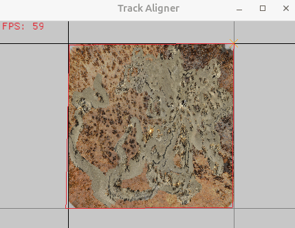
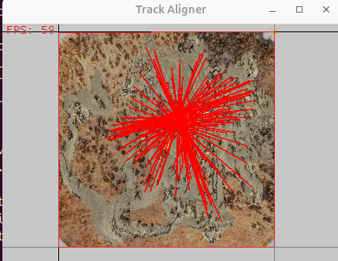
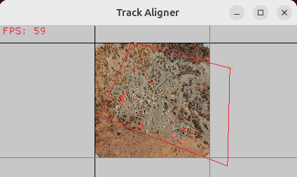
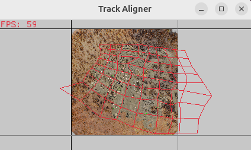
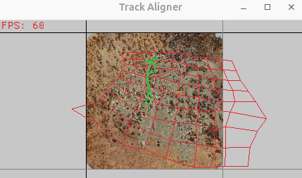

# Image Aligner & Tools
This is the repository for the _Image Aligner_, a software to manually map one image onto another.
It is the basis of the dataset alignment phase used in the paper &lt;TODO, A PAPER NEEDS TO BE LINKED HERE&gt;.

What proceeds is [information speficially about the tool](#Tool-Compilation-and-Basic-Usage) (and it's helper tools), building and running them, followed by instructions on using them to recreate Figure 1 in the previous mentioned paper as a "full-usage example".

## Tool Compilation and Basic Usage
The primary program in here (the "Image Aligner") implements a multi-patch image aligner, used to calculate and store the warpmesh required to transform one image (the **offset**) - and an abitrary CSVs of points in that image's coordinate space - into the coordinate space of another (the **baseline**).
It does this by displaying the **offset** image over the top of the **baseline** at varying selectable degrees of transparency, and allowing the user to move the corners of the **offset** image.
Once the user is happy with the initial alignment of the four corners of the image, it can be _sub-divided_ into multiple sub-images, which each can be manipulated to form the _warpmesh_ that maps the **offset** onto the **baseline**.
To aid the user in doing this points that are known to be the same in both images (**correspondence points**) can be marked on both images, and a visual indicator of the distance between them shown.

Also included are a few [tools](tools) that make processing associated data being fed into or taken out of the program a little easier to manage. They are documented on the readme of the folder they exist within, linked.

### Building
The program is written in Rust, which can be attained through a single-line command using [rustup](https://rust-lang.org/tools/install/).

The program can then be compiled with the command:
```
$ cargo build --release
```

All dependencies will be downloaded and compiled.

### Usage

The program can be run by executing the built executable found at `target/release/image-aligner`. Program help can be accessed by passing the `-h` argument:

```
Usage:
  target/debug/track-aligner [OPTIONS] BASELINE_IMAGE OFFSET_IMAGE

Aligns two images through a multi-patch warp. Press 'h' for hotkeys.

Positional arguments:
  BASELINE_IMAGE        Path to the baseline image (the one that will not be
                        warped)
  OFFSET_IMAGE          Path to the offset image (the one that will be warped)

Optional arguments:
  -h,--help             Show this help message and exit
  -s,--start-points START_POINTS
                        Comma-separated list of four points in the baseline
                        image-space that will be used as a starting point for
                        the warp search. Row-major order. Each point is a
                        comma-separated pair of numbers, e.g.
                        "(0,0),(1,0),(0,1),(1,1)" (including quotation marks)
  -i,--input-file INPUT_FILE
                        Path to a file from a previously saved session (saving
                        is done with the 's' key).
  -t,--input-track-file INPUT_TRACK_FILE
                        Path to a track CSV file to load.
  -p,--process-points   If enabled, the program simply immediately processes
                        the track supplied with -t against the supplied
                        pointset and then closes.
  -c,--input-correspondences-file INPUT_CORRESPONDENCES_FILE
                        Path to a .pts correspondences file to load.
```

When in-program, the controls are as follows:
```
   Hotkeys
-------------------------------------------------------------------
q       - Quit.
tab     - subdivide the current warp mesh.
up/down - increase/decrease opacity of the offset image.
1-9     - set the opacity of the offset image to decimal divisions.
s       - Save the current warp mesh.
t       - save the loaded Track in baseline imagespace.
m       - show/hide the warpMesh and correspondence lines.
h       - display this Help text.
b       - stage a correspondence point in Baseline space.
o       - stage a correspondence point in Offset space.
c       - Commit the staged correspondence points.
p       - save the current Point correspondences.
```

## Full Usage Example
  
*An excerpt from Figure 1 of the paper, showing the final warp alignment at it's early and late stages.*

In the paper, the image aligner is used to align an **offset** generated mosaic of top-down photographs taken and combined to form an image of the *real-world* landscape that *Cataglyphis Velox* ants used to navigate during a previous experiment to a 3D rendered image of the same environment using 3D lidar scan data (the **baseline**).
The generated mosaic image and related ant tracks were sourced from the [CATER dataset](https://www.science.org/doi/10.1126/sciadv.adg2094), while the 3D environment of Seville, Spain, that the experimental work was derived from the [Habitat3D project](https://insectvision.dlr.de/3d-reconstruction-tools/habitat3d).
However, you can find a repository of the combined data [here](https://orda.shef.ac.uk/articles/dataset/Dataset_Reconstructing_the_visual_histories_of_desert_ants/32860832) within the "Track Aligner" folder. This contains track data that has been normalised to the baseline image coordinates and is convenient.

The following walkthrough will use the files linked above. The content of these files is discribed below:
| Filename | Description |
|----------|-------------|
| top-down-habitat-render(-14,14)-(14,-14).png | An orthographic rendering of the Seville environment as captured in 3D by the Habitat3D project. This rendering was taken such that the top left and bottom right corners have X/Y coordinates *(-14,14)* and *(14,-14)* within the 3D environment (assuming the Z heading is the vertical axis). This will form our **baseline space** image. |
| to-down-image-render.png | A combined top-down image mosaic of the Seville environment, as numerous ants travelled within it, taken from CATER and adjusted to have a transparent background. This will form our **offset space** image. |
| correspondance-points.pts | A set of 97 correspondences between the offset and baseline images - points that represent the same object in both. |
| single-patch-warpmesh.wrp | A configured warpmesh that only uses only a single patch (four corners) to attempt to fit the offset to the baseline (the left image in the above excerpt). |
| multi-patch-warpmesh.wrp | A configured warpmesh that uses 64 patches (81 corners) to to fit the offset image to the baseline better than the single-patch variant. |
| 2D_Ant_Tracks_In_ImageSpace_Seville | A folder containing the recorded ant tracks within the Seville imagespace (our **offset** imagespace). This is almost identical to that provided by the CATER dataset, however these tracks have been normalised to be in the coordinate space (0,0) to (1,1) to properly be defined within the imagespace itself, rather than using the pixel-wise coordinates of the original data. This normalisation was done using the `track-normaliser.py` tool within the [tools](tools/) folder.
| 2D_Ant_Tracks_In_HabitatSpace_Seville | A folder containing the recorded ant tracks warped to be within the Habitat3D imagespace (our **baseline** imagespace). This is the result of applying the full multi-patch warpmesh to all tracks currently in the Seville imagespace, and is what will be produced by the end of this walkthrough. |

Note that if you are having issues running the program with the larger image files, or they are taking too long to load, you can choose to use one of the available variations of the large images present in the `low-memory-images` folder.
In particular, the `*-small` variants are useful for quickly getting used to the program.

In the following sections, it is assumed that you have downloaded the content of the ORDA repository to the `data/` folder.

### Opening a Baseline and Offset Image
Initially opening the program with `top-down-habitat-render-(-14,14)-(14,-14).png` as the **baseline**, and `top-down-image-render.png` as the **offset**, you are presented with the mosaic image overlaid on top of the baseline and streched to completely fill it's area - the offset image can be dragged around by it's four corners to palce it at different transforms across the baseline image:  
  
*Produced using `target/release/image-aligner data/top-down-habitat-render-\(-14\,14\)-\(14\,-14\).png data/top-down-image-render.png`*

Warpmeshes can be saved by pressing 's', which will save a `.wrp` file with the current datetime that stores the warpmesh.
By pressing the number keys 0-9 (or the up/down arrows), the opacity of the offset image can be changed to better see the baseline image below to better match the two images.

### Adding Correspondence Points
A pair of correspondence points can be added to the baseline and offset image respectively by pressing 'b' and 'o', then 'committed' to the current set of points by pressing 'c'. These correspondence pointsets can then be saved with 'p', which produces a `.pts` file (saved as a datetime stamp), which can be loaded using the `-c` or `--correspondence-input-file` program flags. Here you can see the loaded 97-correspondence correspondence set **correspondance-points.pts** as it is first seen when loading the seville image- and habitat3D model-space images:  
  
*Produced using `target/release/image-aligner data/top-down-habitat-render-\(-14\,14\)-\(14\,-14\).png data/top-down-image-render.png -c data/correspondence-points.pts`*

Note that the loaded correspondence points show at first that the images are 180 degrees out of rotation with each other - this is because the coordinate systems in the Habitat3D modelspace image is 180 degrees out of rotation with the Seville imagespace image.

### Loading Presaved Warpmeshes
Warpmeshes can be loaded using the `-i` or `--input-file` program flags, which will ingest a `.wrp` file and load the warpmesh with that file's contents. Below are the two displayed warpmeshes from figure 1 of the paper - the single-patch warpmesh and the multi-patch warpmesh, which was gained from a period of user interaction to align the two images. Also loaded are the correspondence points from before, to show how much improvement in representation a multi-patch warp has over a single:  
  
*Produced using `target/release/image-aligner data/top-down-habitat-render-\(-14\,14\)-\(14\,-14\).png data/top-down-image-render.png -c data/correspondence-points.pts -i data/single-patch-warpmesh.wrp`*

  
*Produced using `target/release/image-aligner data/top-down-habitat-render-\(-14\,14\)-\(14\,-14\).png data/top-down-image-render.png -c data/correspondence-points.pts -i data/multi-patch-warpmesh.wrp`*

### Loading and Visualising Track Data
When warping the mesh, it might not be enough to just change the opacity of the offset image and to see correspondence points, sometimes you may want to sanity check your work by loading track data into the image.
Track data, in the imagespace of the offset image (here the seville imagespace image) can be loaded with the `-t` or `--input-track-file` program flags, to load and display a track across the offset space. As the offset space is warped, so too is the track:  
  
*Produced using `target/release/image-aligner data/top-down-habitat-render-\(-14\,14\)-\(14\,-14\).png data/top-down-image-render.png -c data/correspondence-points.pts -i data/multi-patch-warpmesh.wrp -t data/2D_Ant_Tracks_In_ImageSpace_Seville/Ant03R03.csv-normalised.csv`*


